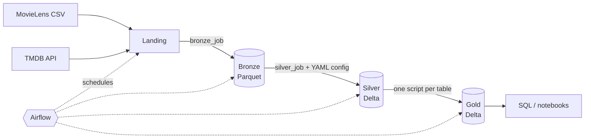

# Movie Lakehouse

**English** | [Tiếng Việt](README.vi.md)
 
An end-to-end batch data pipeline that builds a **Medallion lakehouse** (Bronze → Silver → Gold) from MovieLens and TMDB data, using **Apache Spark**, **Delta Lake**, **Airflow** and S3-compatible storage (**SeaweedFS**), all running locally with Docker Compose.
 
The project focuses on how a data platform actually works rather than on the dataset: incremental loading with two **CDC strategies**, a **config-driven (YAML) framework** for the repetitive layers, **idempotent** jobs, data-quality checks, and planned **Spark performance experiments**.

> **Status: work in progress.** The infrastructure, the Spark + Delta + SeaweedFS smoke test and the Bronze layer have been run and verified. Silver, Gold and the Airflow DAG are implemented but not yet verified end-to-end.
 
---
 
## Architecture
 

 
All three layers live in separate buckets on SeaweedFS, accessed by Spark through the `s3a://` connector.
 
| Layer | Bucket | Content | Format |
|---|---|---|---|
| Bronze | `bronze` | Raw data, unchanged, all columns as string, plus `_ingested_at` and `_source_file` | Parquet |
| Silver | `silver` | Typed, validated, de-duplicated, CDC applied | Delta |
| Gold | `gold` | Analytics-ready dimensional model and aggregates | Delta |
| (meta) | `meta` | CDC checkpoints and scratch tables | JSON / Delta |
 
## Tech stack
 
| Component | Choice | Why |
|---|---|---|
| Processing | Apache Spark 3.5.6 (standalone cluster: 1 master, 1 worker) | Distributed processing, close to a real cluster setup |
| Table format | Delta Lake 3.3.2 | ACID, `MERGE`, time travel, `OPTIMIZE` on top of Parquet |
| Storage | SeaweedFS (S3 API) | S3-compatible object storage, runs in one container |
| S3 connector | `hadoop-aws` 3.3.4 | Must match the Hadoop version bundled with Spark 3.5.x |
| Orchestration | Apache Airflow 2.10.5 | Scheduling, dependencies, retries |
| Packaging | Docker Compose | One command to start the whole stack |
| Language | Python (PySpark), SQL, YAML | |
 
Version pinning is deliberate: Delta must match the Spark version and `hadoop-aws` must match Spark's Hadoop version, otherwise jobs fail with `NoSuchMethodError` / `NoClassDefFoundError`.
 
## Data sources
 
| Source | Content | Used for |
|---|---|---|
| [MovieLens](https://grouplens.org/datasets/movielens/) (`ml-latest-small`) | Ratings, movies, links | User behavior facts, movie catalog, ID mapping |
| [TMDB API](https://www.themoviedb.org/) | Budget, revenue, runtime, genres, daily popularity and votes | Movie attributes and daily snapshots |
 
Data files are **not** included in this repository. MovieLens is licensed for research and education only and must not be redistributed; download it with the provided script.
 
*This product uses the TMDB API but is not endorsed or certified by TMDB.*
 
## Repository structure
 
```
movie-lakehouse/
├── docker-compose.yml
├── .env.example
├── docker/
│   ├── spark/Dockerfile          # Spark image + PyYAML
│   └── airflow/Dockerfile        # Airflow image + Docker CLI
├── conf/
│   ├── spark-defaults.conf       # Delta + s3a configuration
│   └── seaweedfs-s3.json         # S3 credentials for the local store
├── config/
│   ├── bronze/                   # one YAML per source
│   └── silver/                   # one YAML per table (schema, PK, DQ, CDC, writer)
├── src/
│   ├── common/                   # config loader, checkpoint, transforms, CDC, writers
│   ├── jobs/                     # generic bronze_job.py and silver_job.py
│   └── gold/                     # one script per Gold table
├── dags/movie_pipeline.py        # Airflow DAG generated from the config folder
├── scripts/                      # smoke test, data download, TMDB fetch, bucket init
└── data/landing/                 # downloaded data (git-ignored)
```
 
## Quick start
 
**Prerequisites:** Docker (with Compose), Python 3 on the host (for the download script), a free [TMDB API key](https://www.themoviedb.org/settings/api). About 8 GB of free RAM is recommended.
 
On Windows use **WSL 2** (recommended) or Git Bash with `export MSYS_NO_PATHCONV=1`, since the commands below are bash.
 
```bash
# 1. Configure
cp .env.example .env              # then put your TMDB_API_KEY in .env
 
# 2. Start the stack
docker compose up -d --build
bash scripts/init_buckets.sh      # creates bronze, silver, gold, meta
 
# 3. Verify Spark + Delta + SeaweedFS work together (expect the printed count to be 5)
docker exec spark-master /opt/spark/bin/spark-submit \
  --master spark://spark-master:7077 --conf spark.driver.host=spark-master \
  /opt/project/scripts/smoke_test.py
 
# 4. Get the data
python3 scripts/download_movielens.py
docker exec -u root spark-master python3 /opt/project/scripts/fetch_tmdb.py \
  --p-date 2026-10-22 --limit 300
```
 
Run the layers by hand (or trigger the `movie_pipeline` DAG at http://localhost:8080):
 
```bash
submit() { docker exec spark-master /opt/spark/bin/spark-submit \
  --master spark://spark-master:7077 --conf spark.driver.host=spark-master "$@"; }
 
# Bronze: one generic job, one config per source
submit /opt/project/src/jobs/bronze_job.py --table movielens_ratings   --p-date 2026-10-22
submit /opt/project/src/jobs/bronze_job.py --table movielens_movies    --p-date 2026-10-22
submit /opt/project/src/jobs/bronze_job.py --table movielens_links     --p-date 2026-10-22
submit /opt/project/src/jobs/bronze_job.py --table tmdb_movie_details  --p-date 2026-10-22
 
# Silver: one generic job, behavior selected by config
submit /opt/project/src/jobs/silver_job.py --table ratings              --p-date 2026-10-22
submit /opt/project/src/jobs/silver_job.py --table movie_daily_snapshot --p-date 2026-10-22
submit /opt/project/src/jobs/silver_job.py --table movie                --p-date 2026-10-22
 
# Gold
submit /opt/project/src/gold/dim_movie.py
submit /opt/project/src/gold/fact_rating.py
submit /opt/project/src/gold/fact_movie_daily_snapshot.py --p-date 2026-10-22
submit /opt/project/src/gold/agg_genre_stats.py
```
 
UIs: Spark master `http://localhost:8081`, running job `http://localhost:4040`, Airflow `http://localhost:8080`.
 
## How the pipeline works
 
### Hybrid design: config for the common parts, code for the specific parts
 
| In YAML config | In Python code |
|---|---|
| Source path and format | Gold table logic (joins, aggregates) |
| Column renaming and casting | Matching IDs across sources |
| Primary key | Anything that does not repeat across tables |
| Data-quality rules (not null, min, max) | |
| CDC type, writer type, target path | |
 
Bronze and Silver each run one generic job that reads a YAML file, so adding a source or a table means adding a config file, not new job code. The Airflow DAG also scans the config folders to generate its tasks.
 
Example (`config/silver/ratings.yaml`):
 
```yaml
name: ratings
source: {path: s3a://bronze/movielens/ratings, format: parquet}
columns:
  userId:    {to: user_id,  type: int,    nullable: false}
  rating:    {to: rating,   type: double, nullable: false, min: 0.5, max: 5.0}
  timestamp: {to: rated_at, type: timestamp, epoch: true, nullable: false}
primary_key: [user_id, movie_id]
cdc:    {type: "1.1", checkpoint_column: rated_at}
writer: {type: insert_only_merge}
target: {path: s3a://silver/ratings}
```
 
### Change data capture (CDC)
 
The sources are files and APIs with no change log, so CDC here means detecting changes on the Spark side. Two strategies are implemented:
 
| Table | CDC | How it works |
|---|---|---|
| `ratings` | **1.1** (new rows only) | Read rows newer than a stored checkpoint, `MERGE` insert-only, advance the checkpoint |
| `movie_daily_snapshot` | **1.1** (by partition) | Read the day's partition, overwrite exactly that `p_date` partition with `replaceWhere` |
| `movie` | **5** (full load, hash compare) | Load the full source, hash the business columns, compare with the current table, label rows `CDC_INSERT` / `CDC_UPDATE` / `CDC_DELETE` (soft delete via `record_status = 0`), `MERGE` the changes |
 
Why these choices:
 
- Ratings and daily snapshots are append-only events, so reading only new data is enough and cheap.
- The movie catalog has no trustworthy "updated at" column and can lose rows, so only a full comparison can detect updates and deletes.
- Volatile metrics (`popularity`, votes) are kept in the daily snapshot table, not in the dimension. If they were part of the dimension, its hash would change every day and CDC 5 would flag every row as an update.

### Data quality and safety
 
- Rules from YAML are applied in Silver; the job prints how many rows passed and how many were rejected.
- The CDC 5 job **refuses to run on an empty source**, because an empty source would otherwise mark every existing row as deleted.
- All jobs are **idempotent**: re-running the same day does not create duplicates (insert-only `MERGE`, partition overwrite, hash comparison). This makes Airflow retries safe.

### Gold model
 
| Table | Type | Grain |
|---|---|---|
| `dim_movie` | Dimension | One row per MovieLens movie, enriched with TMDB attributes |
| `fact_rating` | Fact | One row per user rating, partitioned by year |
| `fact_movie_daily_snapshot` | Fact (snapshot) | One row per movie per day |
| `agg_genre_stats` | Aggregate | One row per genre (rating count and average) |
 
## Performance experiments
 
Planned experiments, to be run once the Gold layer is built. Results will be added here.

| # | Experiment | What to observe |
|---|---|---|
| A | Broadcast join vs sort-merge join on `fact_rating` ⨝ `dim_movie` | Number of `Exchange` nodes, stages and run time |
| B | Partition pruning on `rated_year` | `PartitionFilters` in the physical plan |
| C | Adaptive Query Execution on/off | Number of tasks after the shuffle |
| D | Small files vs `OPTIMIZE` | `numFiles` before and after |
| E | Reading a Delta table as plain Parquet vs as Delta | Row count difference caused by files replaced by `MERGE` |
 
## Limitations and next steps
 
- Runs on one machine with a single worker; it demonstrates the architecture, not production throughput. Delta on object storage assumes **one writer per table at a time** (Airflow runs the jobs sequentially).
- Gold tables are rebuilt in full on each run, except the daily snapshot; incremental Gold is a next step.
- Airflow calls Spark through `docker exec` with the Docker socket mounted. This is acceptable for a local demo, not for production, where `SparkSubmitOperator` or Kubernetes would be used.
- No history (HIST) table for the dimension yet.

Planned: a history table for `dim_movie`, IMDb as a second CDC 5 source, `ml-25m` to study data skew, `pytest` tests for the CDC and data-quality functions, and an Apache Iceberg variant of the Silver layer.
 
## Troubleshooting
 
| Symptom | Likely cause |
|---|---|
| `NoSuchMethodError` / `ClassNotFoundException` for S3A | `hadoop-aws` version does not match Spark's Hadoop (use 3.3.4 with Spark 3.5.x) |
| `NoClassDefFoundError: SupportsNonDeterministicExpression` | Delta version does not match Spark (use Delta 3.3.x with Spark 3.5.2+) |
| `403` / `SignatureDoesNotMatch` | Keys in `conf/spark-defaults.conf` differ from `conf/seaweedfs-s3.json` |
| `The specified bucket does not exist` | Run `scripts/init_buckets.sh` |
| First job is very slow | Spark is downloading the Delta and hadoop-aws jars |
| Paths turn into `C:/Program Files/Git/...` | Git Bash path conversion: `export MSYS_NO_PATHCONV=1` |
 
## License
 
No license has been chosen for the code yet. Datasets belong to their respective owners (GroupLens, TMDB) and are subject to their own terms.