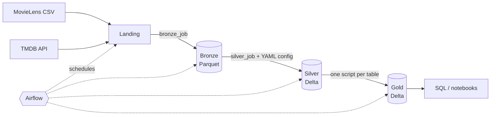

# Movie Lakehouse

[English](README.md) | **Tiếng Việt**

Một pipeline dữ liệu batch end-to-end xây dựng **lakehouse theo kiến trúc Medallion** (Bronze → Silver → Gold) từ dữ liệu MovieLens và TMDB, dùng **Apache Spark**, **Delta Lake**, **Airflow** và lưu trữ tương thích S3 (**SeaweedFS**), toàn bộ chạy local bằng Docker Compose.

Dự án tập trung vào cách một nền tảng dữ liệu thực sự vận hành hơn là vào bản thân bộ dữ liệu: nạp tăng dần với hai **chiến lược CDC**, một **framework điều khiển bằng config (YAML)** cho các tầng có logic lặp lại, các job **idempotent**, kiểm tra chất lượng dữ liệu, và các **thí nghiệm hiệu năng Spark** (dự kiến).

> **Trạng thái: đang phát triển.** Hạ tầng, smoke test Spark + Delta + SeaweedFS và tầng Bronze đã được chạy và kiểm chứng. Silver, Gold và DAG Airflow đã được viết nhưng chưa kiểm chứng end-to-end.

---

## Kiến trúc



Ba tầng nằm ở các bucket riêng trên SeaweedFS, Spark truy cập qua connector `s3a://`.

| Tầng | Bucket | Nội dung | Định dạng |
|---|---|---|---|
| Bronze | `bronze` | Dữ liệu thô giữ nguyên, mọi cột là string, thêm `_ingested_at` và `_source_file` | Parquet |
| Silver | `silver` | Đã ép kiểu, kiểm tra, bỏ trùng, áp dụng CDC | Delta |
| Gold | `gold` | Mô hình chiều và bảng tổng hợp sẵn sàng cho phân tích | Delta |
| (meta) | `meta` | Checkpoint CDC và bảng tạm | JSON / Delta |

## Công nghệ

| Thành phần | Lựa chọn | Lý do |
|---|---|---|
| Xử lý | Apache Spark 3.5.6 (cluster standalone: 1 master, 1 worker) | Xử lý phân tán, gần với mô hình cluster thực tế |
| Table format | Delta Lake 3.3.2 | ACID, `MERGE`, time travel, `OPTIMIZE` trên nền Parquet |
| Lưu trữ | SeaweedFS (S3 API) | Object storage tương thích S3, chạy trong một container |
| Connector S3 | `hadoop-aws` 3.3.4 | Phải khớp phiên bản Hadoop đi kèm Spark 3.5.x |
| Điều phối | Apache Airflow 2.10.5 | Lên lịch, phụ thuộc giữa các task, retry |
| Đóng gói | Docker Compose | Một lệnh khởi động toàn bộ stack |
| Ngôn ngữ | Python (PySpark), SQL, YAML | |

Việc cố định phiên bản là có chủ ý: Delta phải khớp phiên bản Spark và `hadoop-aws` phải khớp phiên bản Hadoop của Spark, nếu không job sẽ lỗi `NoSuchMethodError` / `NoClassDefFoundError`.

## Nguồn dữ liệu

| Nguồn | Nội dung | Dùng cho |
|---|---|---|
| [MovieLens](https://grouplens.org/datasets/movielens/) (`ml-latest-small`) | Đánh giá, danh sách phim, liên kết ID | Fact hành vi người dùng, danh mục phim, ánh xạ ID |
| [TMDB API](https://www.themoviedb.org/) | Ngân sách, doanh thu, thời lượng, thể loại, độ phổ biến và lượt vote hằng ngày | Thuộc tính phim và snapshot hằng ngày |

Repo này **không** chứa file dữ liệu. MovieLens chỉ được cấp phép cho nghiên cứu và giáo dục, không được phân phối lại; hãy tải bằng script đi kèm.

*This product uses the TMDB API but is not endorsed or certified by TMDB.*

## Cấu trúc repo

```
movie-lakehouse/
├── docker-compose.yml
├── .env.example
├── docker/
│   ├── spark/Dockerfile          # image Spark + PyYAML
│   └── airflow/Dockerfile        # image Airflow + Docker CLI
├── conf/
│   ├── spark-defaults.conf       # cấu hình Delta + s3a
│   └── seaweedfs-s3.json         # khóa S3 cho kho lưu trữ local
├── config/
│   ├── bronze/                   # một YAML cho mỗi nguồn
│   └── silver/                   # một YAML cho mỗi bảng (schema, PK, DQ, CDC, writer)
├── src/
│   ├── common/                   # config loader, checkpoint, transforms, CDC, writers
│   ├── jobs/                     # bronze_job.py và silver_job.py dùng chung
│   └── gold/                     # một script cho mỗi bảng Gold
├── dags/movie_pipeline.py        # DAG Airflow sinh từ thư mục config
├── scripts/                      # smoke test, tải dữ liệu, lấy TMDB, tạo bucket
└── data/landing/                 # dữ liệu tải về (bị git bỏ qua)
```

## Bắt đầu nhanh

**Yêu cầu:** Docker (có Compose), Python 3 trên máy host (cho script tải dữ liệu), một [TMDB API key](https://www.themoviedb.org/settings/api) miễn phí. Nên còn trống khoảng 8 GB RAM.

Trên Windows hãy dùng **WSL 2** (khuyến nghị) hoặc Git Bash với `export MSYS_NO_PATHCONV=1`, vì các lệnh bên dưới là bash.

```bash
# 1. Cấu hình
cp .env.example .env              # rồi điền TMDB_API_KEY vào .env

# 2. Khởi động stack
docker compose up -d --build
bash scripts/init_buckets.sh      # tạo bronze, silver, gold, meta

# 3. Kiểm tra Spark + Delta + SeaweedFS chạy cùng nhau (kỳ vọng số dòng in ra là 5)
docker exec spark-master /opt/spark/bin/spark-submit \
  --master spark://spark-master:7077 --conf spark.driver.host=spark-master \
  /opt/project/scripts/smoke_test.py

# 4. Lấy dữ liệu
python3 scripts/download_movielens.py
docker exec -u root spark-master python3 /opt/project/scripts/fetch_tmdb.py \
  --p-date 2026-10-22 --limit 300
```

Chạy từng tầng bằng tay (hoặc kích hoạt DAG `movie_pipeline` tại http://localhost:8080):

```bash
submit() { docker exec spark-master /opt/spark/bin/spark-submit \
  --master spark://spark-master:7077 --conf spark.driver.host=spark-master "$@"; }

# Bronze: một job chung, mỗi nguồn một config
submit /opt/project/src/jobs/bronze_job.py --table movielens_ratings   --p-date 2026-10-22
submit /opt/project/src/jobs/bronze_job.py --table movielens_movies    --p-date 2026-10-22
submit /opt/project/src/jobs/bronze_job.py --table movielens_links     --p-date 2026-10-22
submit /opt/project/src/jobs/bronze_job.py --table tmdb_movie_details  --p-date 2026-10-22

# Silver: một job chung, hành vi do config quyết định
submit /opt/project/src/jobs/silver_job.py --table ratings              --p-date 2026-10-22
submit /opt/project/src/jobs/silver_job.py --table movie_daily_snapshot --p-date 2026-10-22
submit /opt/project/src/jobs/silver_job.py --table movie                --p-date 2026-10-22

# Gold
submit /opt/project/src/gold/dim_movie.py
submit /opt/project/src/gold/fact_rating.py
submit /opt/project/src/gold/fact_movie_daily_snapshot.py --p-date 2026-10-22
submit /opt/project/src/gold/agg_genre_stats.py
```

Giao diện: Spark master `http://localhost:8081`, job đang chạy `http://localhost:4040`, Airflow `http://localhost:8080`.

## Pipeline hoạt động thế nào

### Thiết kế hybrid: config cho phần chung, code cho phần riêng

| Trong YAML config | Trong code Python |
|---|---|
| Đường dẫn và định dạng nguồn | Logic bảng Gold (join, tổng hợp) |
| Đổi tên và ép kiểu cột | Khớp ID giữa các nguồn |
| Khóa chính | Mọi thứ không lặp lại giữa các bảng |
| Quy tắc chất lượng (not null, min, max) | |
| Loại CDC, loại writer, đường dẫn đích | |

Bronze và Silver mỗi tầng chạy một job chung đọc file YAML, nên thêm một nguồn hoặc một bảng chỉ cần thêm file config, không cần viết job mới. DAG Airflow cũng quét các thư mục config để sinh task.

Ví dụ (`config/silver/ratings.yaml`):

```yaml
name: ratings
source: {path: s3a://bronze/movielens/ratings, format: parquet}
columns:
  userId:    {to: user_id,  type: int,    nullable: false}
  rating:    {to: rating,   type: double, nullable: false, min: 0.5, max: 5.0}
  timestamp: {to: rated_at, type: timestamp, epoch: true, nullable: false}
primary_key: [user_id, movie_id]
cdc:    {type: "1.1", checkpoint_column: rated_at}
writer: {type: insert_only_merge}
target: {path: s3a://silver/ratings}
```

### Change data capture (CDC)

Các nguồn là file và API không có nhật ký thay đổi, nên CDC ở đây nghĩa là phát hiện thay đổi ở phía Spark. Có hai chiến lược:

| Bảng | CDC | Cách hoạt động |
|---|---|---|
| `ratings` | **1.1** (chỉ dòng mới) | Đọc các dòng mới hơn checkpoint đã lưu, `MERGE` chỉ INSERT, nâng checkpoint |
| `movie_daily_snapshot` | **1.1** (theo partition) | Đọc partition của ngày, ghi đè đúng partition `p_date` bằng `replaceWhere` |
| `movie` | **5** (full load, so hash) | Nạp toàn bộ nguồn, băm các cột nghiệp vụ, so với bảng hiện có, gắn nhãn `CDC_INSERT` / `CDC_UPDATE` / `CDC_DELETE` (xóa mềm qua `record_status = 0`), rồi `MERGE` phần thay đổi |

Vì sao chọn như vậy:

- Đánh giá và snapshot hằng ngày là dữ liệu chỉ thêm (append-only), nên chỉ cần đọc phần mới là đủ và rẻ.
- Danh mục phim không có cột "updated at" đáng tin và có thể mất dòng, nên chỉ so sánh toàn bộ mới phát hiện được cập nhật và xóa.
- Các số liệu hay đổi (`popularity`, vote) được để ở bảng snapshot hằng ngày chứ không nằm trong dimension. Nếu chúng thuộc dimension, hash sẽ đổi mỗi ngày và CDC 5 sẽ coi mọi dòng đều là UPDATE.

### Chất lượng dữ liệu và an toàn

- Các quy tắc từ YAML được áp dụng ở Silver; job in ra số dòng đạt và số dòng bị loại.
- Job CDC 5 **từ chối chạy khi nguồn rỗng**, vì nguồn rỗng sẽ khiến mọi dòng hiện có bị đánh dấu xóa.
- Mọi job đều **idempotent**: chạy lại cùng một ngày không sinh dòng trùng (MERGE chỉ INSERT, ghi đè partition, so sánh hash). Nhờ vậy retry của Airflow an toàn.

### Mô hình Gold

| Bảng | Loại | Grain |
|---|---|---|
| `dim_movie` | Dimension | Một dòng cho mỗi phim MovieLens, bổ sung thuộc tính TMDB |
| `fact_rating` | Fact | Một dòng cho mỗi đánh giá của người dùng, partition theo năm |
| `fact_movie_daily_snapshot` | Fact (snapshot) | Một dòng cho mỗi phim mỗi ngày |
| `agg_genre_stats` | Tổng hợp | Một dòng cho mỗi thể loại (số đánh giá và điểm trung bình) |

## Thí nghiệm hiệu năng

Các thí nghiệm dự kiến, sẽ chạy sau khi tầng Gold được dựng xong. Kết quả sẽ được bổ sung tại đây.

| # | Thí nghiệm | Cần quan sát |
|---|---|---|
| A | Broadcast join và sort-merge join trên `fact_rating` ⨝ `dim_movie` | Số node `Exchange`, số stage và thời gian chạy |
| B | Partition pruning theo `rated_year` | `PartitionFilters` trong physical plan |
| C | Bật/tắt Adaptive Query Execution | Số task sau shuffle |
| D | File nhỏ và `OPTIMIZE` | `numFiles` trước và sau |
| E | Đọc bảng Delta bằng Parquet thuần và bằng Delta | Chênh lệch số dòng do các file bị `MERGE` thay thế |

## Hạn chế và bước tiếp theo

- Chạy trên một máy với một worker; dự án minh họa kiến trúc, không phải thông lượng production. Delta trên object storage giả định **mỗi bảng chỉ có một writer tại một thời điểm** (Airflow chạy các job tuần tự).
- Các bảng Gold được dựng lại toàn bộ mỗi lần chạy, trừ bảng snapshot hằng ngày; Gold tăng dần là bước tiếp theo.
- Airflow gọi Spark qua `docker exec` với Docker socket được mount. Cách này chấp nhận được cho demo local, không phù hợp production, nơi người ta dùng `SparkSubmitOperator` hoặc Kubernetes.
- Chưa có bảng lịch sử (HIST) cho dimension.

Dự kiến: bảng lịch sử cho `dim_movie`, IMDb làm nguồn CDC 5 thứ hai, `ml-25m` để nghiên cứu data skew, kiểm thử `pytest` cho các hàm CDC và chất lượng dữ liệu, và một biến thể Apache Iceberg cho tầng Silver.

## Xử lý lỗi thường gặp

| Triệu chứng | Nguyên nhân có thể |
|---|---|
| `NoSuchMethodError` / `ClassNotFoundException` liên quan S3A | Phiên bản `hadoop-aws` không khớp Hadoop của Spark (dùng 3.3.4 với Spark 3.5.x) |
| `NoClassDefFoundError: SupportsNonDeterministicExpression` | Phiên bản Delta không khớp Spark (dùng Delta 3.3.x với Spark 3.5.2 trở lên) |
| `403` / `SignatureDoesNotMatch` | Khóa trong `conf/spark-defaults.conf` khác với `conf/seaweedfs-s3.json` |
| `The specified bucket does not exist` | Chạy `scripts/init_buckets.sh` |
| Job đầu tiên rất chậm | Spark đang tải các jar của Delta và hadoop-aws |
| Đường dẫn bị đổi thành `C:/Program Files/Git/...` | Git Bash tự chuyển đổi đường dẫn: `export MSYS_NO_PATHCONV=1` |

## Giấy phép

Chưa chọn giấy phép cho phần code. Các bộ dữ liệu thuộc về chủ sở hữu của chúng (GroupLens, TMDB) và tuân theo điều khoản riêng.
